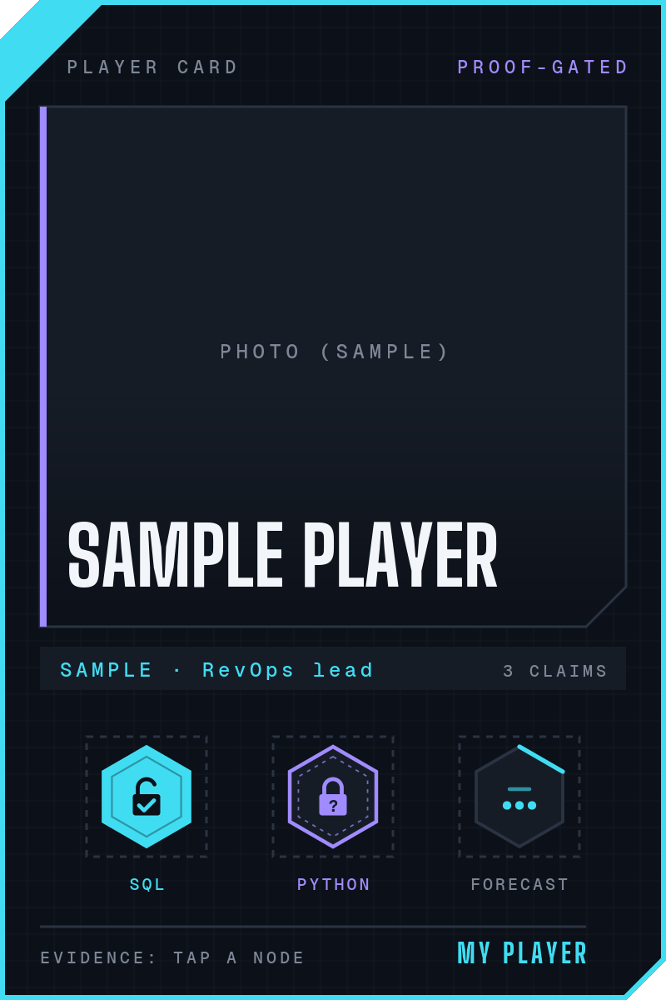
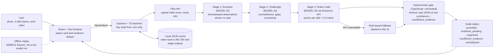

# My Player

**A skill card that only unlocks what the video actually shows.**



*Image: Creative's design mock with SAMPLE data. Not a screenshot of a model run.*

> **Status (Engineering, Nov 21 2026):** built and verified in **offline SAMPLE replay** only. No live Gemini call has been made from this build (no key on the build machine). Every `[MODEL ID]`, `[REAL COUNTS]` and `[DATE/TIME ET]` below stays visibly unfilled until a real run on Mark's laptop fills it. Narrative by Marketing; run steps, architecture notes and provenance by Engineering.

## Quick start

```bash
npm install
cp .env.example .env        # add GEMINI_API_KEY=... for LIVE mode (backend only, never committed)
npm run dev                 # API :8787 + web :5173  ->  open http://localhost:5173
npm run replay              # force OFFLINE REPLAY (SAMPLE fixtures, no key needed, works with wifi off)
```

Full laptop steps: [RUN-ON-LAPTOP.md](RUN-ON-LAPTOP.md). What actually ran and what didn't: [PROVENANCE.md](PROVENANCE.md).

| Command | What it does |
|---|---|
| `npm run dev` | Backend (tsx watch) + Vite frontend. LIVE if `GEMINI_API_KEY` is in `.env`, else SAMPLE replay |
| `npm run replay` | Force SAMPLE replay mode (no network needed) |
| `npm run smoke` | Rule Zero: print SDK version, list models, smoke-test each target, record substitutions to `PROVENANCE.md` |
| `npm test` | Vitest: 36 tests (deterministic gate, JSON validation, timeouts, baseline rule, SAMPLE fixtures, live wiring vs a mocked SDK) |
| `npm run typecheck` | `tsc --noEmit` over server, web, shared, bench |
| `npm run build` then `npm start` | Production build served by Express on :8787 |
| `npm run bench` | Benchmark (flags below) |
| `npm run secret-scan` | Pre-push secret scan; `npm run hooks` installs it as a git pre-push hook |

## The problem

Anyone can say they have a skill. Résumés, profiles and portfolios are mostly claims, and the person reading them has no fast way to tell which claims are backed by evidence. Short work videos help, but someone still has to watch them and decide what was really shown versus what was only said out loud.

My Player is a small experiment in doing that check carefully. You declare three skills, upload a short video of yourself working, and the app builds a player card. A skill node unlocks only when the video shows direct, observable evidence for it. If the evidence isn't there, or anything in the pipeline fails, the node stays locked and tells you why.

The point is not to score people. It is to separate *shown* from *said*, and to be honest when the answer is "we can't tell."

## How it works

1. **Onboard.** Name, role, a consented photo, and three self-declared skill claims.
2. **Upload proof.** One short work video (under 60 seconds). It is uploaded once and the same file reference is reused by every stage.
3. **Stage 1, Extractor.** Produces timestamped observations, each tagged `shown_on_screen` or `only_said_aloud`.
4. **Stage 2, Challenger.** Re-reads the same video alongside Stage 1's output and the claims, and looks for contradictions, unsupported claims, missing visual proof and uncertainty.
5. **Stage 3, Rubric Gate.** For each skill, a yes/no question: "Does the video show direct observable evidence supporting this skill?" Plus a 0 to 3 score on Problem Discovery, Technical Communication and Workflow Execution.
6. **Deterministic gate.** Plain TypeScript rules, unit-tested, decide each node's final state. The models advise; the gate decides.
7. **Evidence drawer.** Click any node to see the timestamped observations (click to jump to that moment in the video), the Challenger's notes, the Rubric Gate result, and the limitations that apply.

### Architecture



### Node states

| State | Meaning |
|---|---|
| `unverified` | Claimed, no video analyzed yet |
| `evidence_pending` | Analysis running |
| `supported` | The video shows direct evidence and every check passed |
| `insufficient_evidence` | Not enough shown, or a stage timed out, returned bad output, or came back below the confidence threshold |
| `contradicted` | The video shows something that conflicts with the claim |

A node never unlocks because something broke. Failure always means locked.

## Honesty and provenance

- **The model badge shows what actually ran.** At startup the app lists the models the key can see and smoke-tests each one. If a planned model isn't available, the closest available one is used, the substitution goes in `PROVENANCE.md`, and the badge shows the real model id. Models that ran: [MODEL ID per stage, from PROVENANCE.md]. (Planned, unverified: `gemini-4-neon` / `gemini-4-carbon` / `gemini-decision-1`.)
- **Real latency on screen.** Each stage shows its measured time in milliseconds. Median latency from the benchmark: [REAL COUNTS].
- **Fallbacks are labeled.** If the Decisions API is unavailable, the exact error is logged and the drawer says "Rule-based fallback, Decisions API unavailable."
- **Offline replay is labeled.** Replay mode uses fixture files marked "SAMPLE / not a live model run." Fixtures are never presented as live output. A cached real run, when used, shows its original timestamp.
- **Test videos are synthetic samples.** The benchmark clips are synthetic screen recordings with generated narration, labeled SAMPLE.
- **No secrets in the repo.** The API key lives only in a local `.env` (git-ignored), and a pre-push scan blocks any push that contains a key pattern.

## Benchmark

We compare a Stage-1-only baseline against the full three-stage pipeline on four cases: clear pass, unsupported claim, partial completion, and an unseen holdout.

| Metric | Stage 1 only | Full 3-stage |
|---|---|---|
| Correct support | [REAL COUNTS] | [REAL COUNTS] |
| Incorrect support | [REAL COUNTS] | [REAL COUNTS] |
| Correct rejection | [REAL COUNTS] | [REAL COUNTS] |
| False refusal | [REAL COUNTS] | [REAL COUNTS] |
| Abstention | [REAL COUNTS] | [REAL COUNTS] |
| Errors | [REAL COUNTS] | [REAL COUNTS] |
| Median latency (ms) | [REAL COUNTS] | [REAL COUNTS] |

n=4, illustrative, not statistically meaningful. Source: `bench/results.json`, run on [DATE/TIME ET] in [live / offline replay] mode. **As of this build the benchmark has NOT been run live**; the table is intentionally empty. Ground truth is Delivery's `fixtures/labels.json`. Protocol: [docs/internal-rd/benchmark-protocol.md](docs/internal-rd/benchmark-protocol.md).

```bash
npm run bench                                   # live if GEMINI_API_KEY in .env, else SAMPLE replay
npm run bench -- --mode live                    # require live (exits 1 without a key)
npm run bench -- --mode replay                  # SAMPLE fixtures through the real gate: NOT a model benchmark
npm run bench -- --cases case2-unsupported-claim,case4-unseen-holdout
npm run bench -- --out bench/results.json       # default output path
```

The **baseline** uses a separate, PROPOSED Stage-1-only rule (Internal R&D): unlock iff at least 1 `shown_on_screen` observation at confidence >= 0.6. Spoken-only never unlocks. Replay-mode counts are circular (Engineering wrote the fixtures from the labels) and must not be reported as results.

## Limitations

- **Four cases is not evidence of accuracy.** The benchmark shows the pipeline behaves as designed on a handful of examples; it does not measure real-world reliability.
- **It only sees what's on screen.** Skills that are real but hard to show in under a minute (judgment, collaboration, long projects) will often come back `insufficient_evidence`. That is by design, and it means a locked node is not proof someone lacks the skill.
- **Models can be wrong.** The Extractor can miss things and the Challenger can over-flag. The deterministic gate limits the damage by refusing to unlock on doubt, but it can't fix a confidently wrong observation.
- **Thresholds are judgment calls.** The confidence cutoffs are documented and adjustable, not learned from data.
- **Not for decisions about people.** No hiring decisions, no personality scoring, no biometric claims. It works only with media the user consented to share.
- **Built in one afternoon.** Some planned pieces may be cut; anything that didn't run is marked as such in the UI and in `PROVENANCE.md`.

## Built with

Gemini models through `@google/genai` (3.6.1 pinned `^3.6.1`, installed and type-checked; live calls not yet run), the Interactions API, the Decisions API, the Files API, React + Vite + TypeScript, Node + Express + TypeScript, and local JSON storage.

## Gate thresholds (all PROPOSED)

| Threshold | Value | Source |
|---|---|---|
| Rubric Gate `noul` P(yes) to unlock | >= 0.70 | PROPOSED, [rationale](docs/internal-rd/gate-thresholds-rationale.md) |
| Decisions API `confidence` minimum | >= 0.50 | PROPOSED (Engineering, per Internal R&D note) |
| Observation confidence to count | >= 0.60 | PROPOSED |
| Qualifying on-screen observations | >= 1 | PROPOSED |
| Per-stage timeout | 45 s | Spec |

`noul` is a calibrated P(yes) in [0.01, 0.99] (External R&D, docs-verified). It is gated once against 0.70; the yes/no label in the UI is display-only. Override via `gate-thresholds.json`. Never tune on the holdout.

## Where the build differs from the diagram above

1. **Stages 1-2 call the Interactions API first** (`ai.interactions.create`, per External R&D's docs-verified facts) and fall back to `models.generateContent` if Interactions is missing or rejects the request. The badge shows `model via API` that actually served the call.
2. **Stage 2 runs only if Stage 1 succeeded.** If Stage 1 fails, Stage 2 is skipped and every node stays `insufficient_evidence`.
3. **Rule-based fallback** triggers both when the startup smoke test finds Decisions unavailable and when a run-time Decisions call fails; the exact error is shown in the drawer.
4. **Offline replay goes through the backend** (`GET /api/replay/:caseId`) so the real deterministic gate runs on SAMPLE fixtures; it is not a frontend-only mock. Uploaded videos are never analyzed in replay mode.
5. **The cache stores a run only when Stages 1 and 2 succeeded**, so a failed run isn't replayed as if real. Cached replays are labeled "CACHED real run from <timestamp>".
6. **The baseline benchmark mode uses its own gate** (`gateStage1Only`), not the full gate.
7. **Palette:** Creative added one color, `--mp-alert #ff6b81`, used only for `contradicted` and API failure.

## Repo map

```
server/src/   index.ts (API) · gemini.ts (live pipeline + Rule Zero) · gate.ts (deterministic gate + baseline) · replay.ts · cache.ts · json.ts · gate.test.ts
web/src/      App.tsx (signature view, card, drawer, benchmark, provenance) · app.css · creative/tokens.css (Creative)
web/public/   creative/ (Creative SVGs) · samples/ (Delivery's 4 SAMPLE mp4s, ~2 MB total)
fixtures/     labels.json (Delivery ground truth) · cases/*.json (hand-authored SAMPLE fixtures, not model output)
bench/        run-bench.ts
docs/         marketing/ · sales/judge-qa.md · internal-rd/ · external-rd/sdk-facts.md · delivery/ · operations/
scripts/      secret-scan.sh (pre-push) · qa_secret_scan.sh (Operations) · smoke.ts
```

API: `GET /api/health` (mode, SDK version, models, substitutions, smoke results; never the key) · `GET /api/replay/:caseId` · `POST /api/analyze` (multipart `video` + `claims` JSON; LIVE only) · `GET /api/bench` · `GET /api/runs`.

## Credits

Narrative and scripts: Marketing. Visual system: Creative (fonts Big Shoulders + Geist Mono, SIL OFL). SAMPLE videos and labels: Delivery (synthetic, local TTS; narration speech check not run). SDK facts: External R&D (docs-verified, not run-verified). Gate thresholds and benchmark protocol: Internal R&D. Judge Q&A: Sales. QA: Operations. Code: Engineering.
